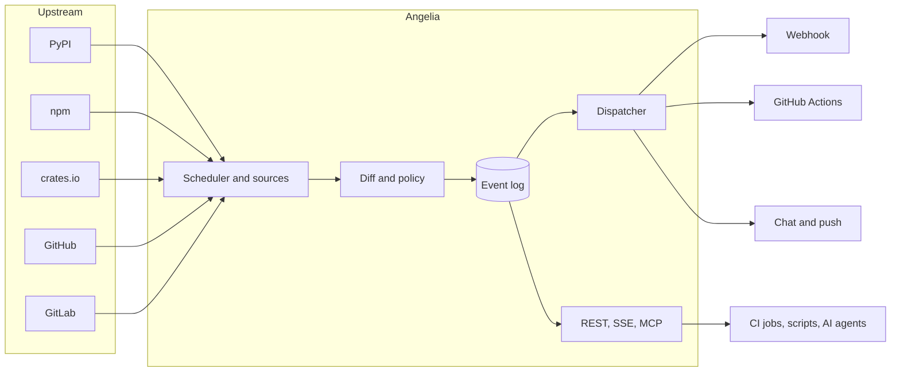

# Concepts

Angelia does three things, in order, and nothing else: **detect** a new version upstream, **normalize** it into
one immutable event, **deliver** that event to whoever subscribed. What to *do* about a release (open a PR,
run tests, ask an agent, post in chat) is the consumer's decision, never the core's.

| Page | What you learn |
|---|---|
| [Components](components.md) | the roles inside the one binary, and how they scale |
| [The release event](release-event.md) | the CloudEvent every consumer receives |
| [Policies](policies.md) | which versions become events, and when |
| [Subscriptions and filters](subscriptions.md) | which events reach which sink |
| [Message templates](templates.md) | shaping the body for chat and webhooks |
| [Security model](security.md) | signing, secrets, the SSRF guard, untrusted data |
