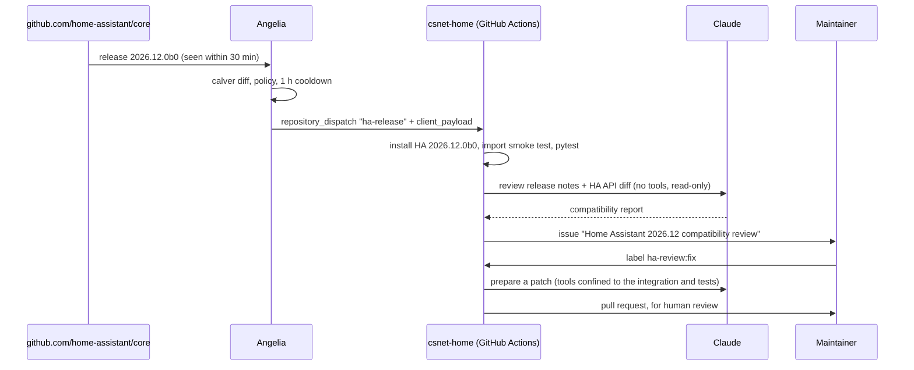

# Home Assistant to an agentic PR

**The job:** [Hitachi CSNet Home](https://github.com/mmornati/home-assistant-csnet-home) is a custom
integration for Home Assistant. Every month Home Assistant ships a release that can break custom integrations.
The maintainer wants, the moment a release lands:

1. the integration's tests to run against that exact version;
2. an AI review of the release notes and of the Home Assistant APIs the integration builds on;
3. a fix PR prepared by an agent, once a human approves it.

Before Angelia, the repository polled PyPI every six hours from a cron job. With Angelia, Home Assistant's
GitHub release **pushes** the work.

<div class="wire-video" markdown>
[:material-play-circle: Watch this recipe as a narrated video](../videos/home-assistant/index.html){ .md-button .md-button--primary }
</div>



## On the Angelia side

```yaml title="watches.yaml"
version: 1

sinks:
  - name: csnet-home-ci
    kind: github-dispatch
    config:
      repo: mmornati/home-assistant-csnet-home
      token_ref: gh-dispatch-csnet          # fine-grained PAT: Contents read/write on that repo only
      event_type: ha-release

watches:
  - name: home-assistant
    source: github-release
    coordinates: { repo: home-assistant/core }
    scheme: calver                          # 2026.11.1, 2026.12.0b0
    interval: 30m
    labels: { consumer: csnet-home }
    policy:
      prerelease: include                   # betas too: find breakage before users do

subscriptions:
  - name: ha-to-csnet-home
    sink: csnet-home-ci
    filter:
      labels: { consumer: csnet-home }
      type: [release.published, release.prerelease]
    policy:
      cooldown: 1h                          # let the PyPI wheel land; drop it if yanked
```

```sh
angelia secret set gh-dispatch-csnet --from-file pat.txt --host api.github.com
angelia config check --config angelia.yaml --watches watches.yaml
```

Why each line is there:

- **`scheme: calver`** makes `2026.12.0b0` a pre-release of `2026.12.0` and computes real bumps between dates.
- **`prerelease: include`** sends betas, which is when breakage is cheapest to fix.
- **`cooldown: 1h`** on the subscription only: Home Assistant publishes the GitHub release a little before the
  PyPI wheel, and a release pulled within the hour never reaches CI.
- **`event_type: ha-release`** lets the repository listen for exactly this, and nothing else Angelia might send.

## On the repository side

One workflow listens for the dispatch, tests the exact version, and starts the review when the monthly release
has none yet.

```yaml title=".github/workflows/angelia-ha-release.yaml"
name: HA Release from Angelia
'on':
  repository_dispatch:
    types: [ha-release]

permissions:
  contents: read

concurrency:                         # a retried delivery carries the same event id
  group: angelia-${{ github.event.client_payload.event_id }}

jobs:
  validate:
    runs-on: ubuntu-latest
    outputs:
      version: ${{ steps.check.outputs.version }}
      release: ${{ steps.check.outputs.release }}
    steps:
      - uses: actions/checkout@v4
      - id: check
        env:                         # untrusted: through env, then validated
          PACKAGE: ${{ github.event.client_payload.package }}
          VERSION: ${{ github.event.client_payload.version }}
        run: |
          [ "$PACKAGE" = "home-assistant/core" ] || { echo "::error::unexpected package"; exit 1; }
          [[ "$VERSION" =~ ^20[0-9]{2}\.[0-9]+\.[0-9]+(b[0-9]+)?$ ]] || { echo "::error::bad version"; exit 1; }
          echo "version=$VERSION" >> "$GITHUB_OUTPUT"
          echo "release=$(echo "$VERSION" | cut -d. -f1,2)" >> "$GITHUB_OUTPUT"

  test:
    needs: validate
    runs-on: ubuntu-latest
    steps:
      - uses: actions/checkout@v4
      - uses: actions/setup-python@v5
        with: { python-version: '3.14' }
      - run: scripts/ci/install_ha.sh "${{ needs.validate.outputs.version }}" tests
      - run: python scripts/ci/import_smoke.py
      - run: pytest tests/ -q --tb=short

  review:
    needs: [validate, test]
    if: always() && needs.validate.result == 'success'
    runs-on: ubuntu-latest
    permissions: { actions: write, issues: read }
    steps:
      - env:
          GH_TOKEN: ${{ github.token }}
          GH_REPO: ${{ github.repository }}
          VERSION: ${{ needs.validate.outputs.version }}
          RELEASE: ${{ needs.validate.outputs.release }}
        run: |
          FOUND=$(gh issue list --label ha-release-review --state all --limit 1 \
            --search "in:title \"Home Assistant ${RELEASE} compatibility review\"" --json number --jq length)
          [ "$FOUND" = "1" ] && { echo "already reviewed"; exit 0; }
          gh workflow run ha-release-review.yaml -f version="$VERSION"
```

The complete file, with a PyPI wait and a job summary, is
[in the repository](https://github.com/mmornati/home-assistant-csnet-home/blob/main/.github/workflows/angelia-ha-release.yaml).

### The agentic part, kept on a leash

The review and the fix are two existing workflows of the repository, built so that third-party text (release
notes, blog posts) can shape a report but never trigger an action:

| Workflow | What the model can do | Who decides |
|---|---|---|
| `ha-release-review.yaml` | one Messages API call, **no tools**, from a job with `contents: read`; a separate job without a model opens the issue | automatic, once per monthly release |
| `ha-review-fix.yaml` | tools confined to `custom_components/` and `tests/`, plus `pytest`; produces a patch, a separate job checks the paths and opens the PR | a maintainer adds the `ha-review:fix` label |

The result is always a pull request for human review, never a merge.

## Tested end to end

On 16 November 2026 this exact configuration (Angelia v0.2.0, with a local mirror of the Home Assistant release
list so that 2026.11.1 appeared as new) emitted
`github-release:home-assistant/core@2026.11.1`, `bump: patch` from `2026.11.0`, `scheme: calver`, and GitHub
accepted the dispatch with `204`.
[The run it started](https://github.com/mmornati/home-assistant-csnet-home/actions/runs/43820805254) validated the
payload, installed Home Assistant 2026.11.1, passed the import smoke test, and skipped the Claude review because
2026.11 already had one. The unit tests waited, as designed, for `pytest-homeassistant-custom-component` to publish
a harness for that version.

## Try it without waiting for a release

The first check of a watch is a baseline, so Angelia stays silent until Home Assistant's next release. To see the
chain end to end today, trigger the same dispatch by hand with the payload Angelia would send:

```sh
gh api repos/mmornati/home-assistant-csnet-home/dispatches \
  -f event_type=ha-release \
  -F 'client_payload[event_id]=manual-test-1' \
  -F 'client_payload[source]=github-release' \
  -F 'client_payload[package]=home-assistant/core' \
  -F 'client_payload[version]=2026.11.1' \
  -F 'client_payload[previous_version]=2026.11.0' \
  -F 'client_payload[bump]=patch'
```

## Adapt it to your integration

Change the repository, the label and the tests; keep the shape: Angelia detects and delivers, the repository
validates the payload, tests run first, the model reads without tools, a human approves before an agent writes.
